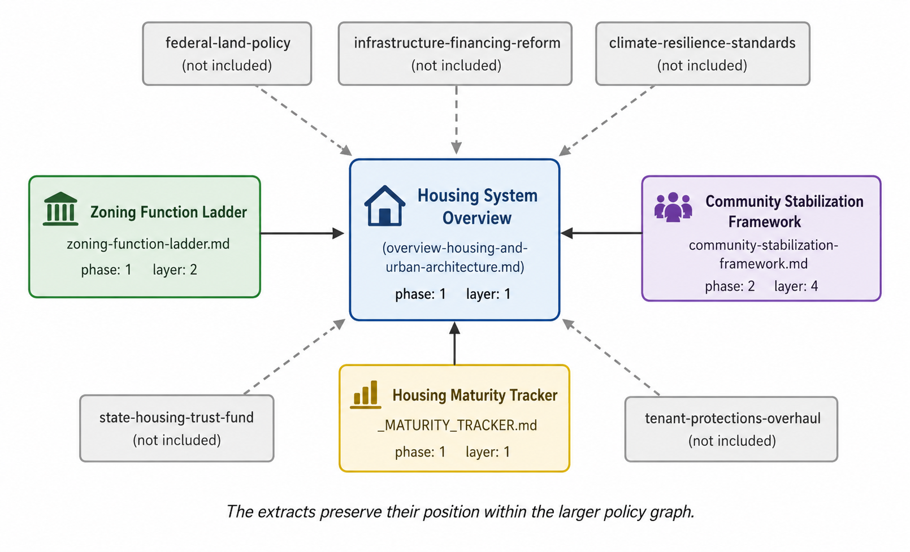

# DevOps for Policy Development: The Benefits of a Machine-Readable Policy Architecture

## Executive Overview

Database and software engineering principles can be applied to a policy document corpus. This allows us to link the physical text of a regulation or policy to other related policies, to link the text of a policy to databases recording the processes they create, and it enables us to run automated gap analysis, red team testing, maturity analysis (during development) and even compare a drafted policy to published case studies and reports in an automated fashion. 

## The problem

Imagine a presidential policy platform. Because the number of policies to hit is so large, they are usually assembled from teams of experts as disparate collections of papers. Energy policies might be drafted by one team, healthcare policy from another -- and while each individual team might be really good at what they do *individually*, their policies can fail if they are not optimized to be deployed together. 

For example, take the push for green energy. If a policy team drafts a battery tax subsidy for Electric Vehicles, that *in isolation* is a subsidy that helps manufacturers offset their largest cost, and subsequently support EV manufacturing in the United States. While that subsidy might scale efficiently on paper, it is being deployed alongside an already complicated system that this manufacturer needs to navigate. In this sense, that subsidy's effects might not be sufficient if the manufacturers are battling an outdated permitting system, upstream supply chain issues (caused by other policies), EPA and government agency backlogs for their factories, meager demand, organized and heavily subsidized industrial competition from other countries, and an outdated IRS infrastructure that supplies them with subsidies only after they hire departments of staff to navigate the complexity of the tax code on their behalf. 

Policies, unlike their paper representations, are deployed into a larger system with gaps, dependencies, and other constraints. But unlike these real life systems, the methods we use for developing these policies do not allow us to fully map and account for these constraints before we implement them.

Thankfully, many of these same issues have been solved in other fields. Meta for example hosts the code for all of it's services, from Instagram, to WhatsApp, to Facebook, to it's AI services, to it's fiber infrastructure in one giant mono-repository. From there, the repository is worked on constantly by different teams, around the world, 24/7 -- While servicing billions of users in a production environment, and any delay or incoherence between different services could cost the company billions. Now while a government is certainly *not* a software company, the textual representations that policy teams draft - just like the code for the apps in a tech company's mono-repository - govern a set of services that people must interact with in the real world. 

And like these mono-repositories, the government even has repo-like structures for storing and versioning it's laws -- However, these laws cannot connect to state and local levels, remains heavily disjointed, and interfears with the governments ability to track how it's policy changes effect the multitudes of different sectors it presides over. In tech world, a company (and its competitors) employ strict CI/CD principles, internal APIs, and shared data structures, to maintain coherence across all of these services at the same time.

This proposal applies those same coherence principles to bring the same level of coherence to policy design. As an example, to go back to the EV vehicle manufacturing policy, there are a surprising number of parallels that a policy team needs to sort out: 

- Which pieces of our EV industrial policy depend on services from other government agencies (EPA, IRS, local councils, etc.), and are the changes we need coherent with what they have on the books? 
- Do the institutions that this policy depends on have the personnel or to capacity to actually implement it?
- How does this policy interact with State or Local level policy decisions, and how do the EV manufacturers navigate it?
- Can we pull all the relevant case studies, think tank research, and university studies and red-team test our proposals?

An industrial policy for EVs must necessarily connect both supply *and* demand side industrial policy, trade policy (including industrial inputs upstream, and market access for completed products dowstream), market dynamics of managing foreign subsidized competition, energy policy (because we need to charge the EVs *somewhere*), tax policy (if we are subsidizing through tax expenditures), and even infrastructure and housing policies (because the charging stations, the home solar panels, the battery packs, and energy demand effect touch on those aspects as well). 

A conventional group of pdfs, and a table of contents cannot track and answer those questions. This framework explains how a digitized system *can*. 

## How it works

The central structure of this framework is that each policy brief is treated as  *both* a human-readable document and a machine-readable object. Using *Docusaurus* open-source standards developed for managing code documentation at Meta, policy object begins with YAML front matter -- a standardized, machine-readable set of conditions that a computer can read organize, and understand. This might look like: 

```yaml
---
id: community-stabilization-framework
title: Community Stabilization — Neighborhood Conditions Framework
subdomain: Prevention_Layer
phase: 1  # capped by hard dependency crisis-response-infrastructure (P1); gate-met phase without cap: 3
layer: 4
audiences:
  - local-government
  - community-organizations
dependencies:
  - crisis-response-infrastructure
  - special-transit-zones
  - housing-supply-stabilization-overlay
tags:
  - community-safety
  - prevention
---
```

This allows us to introduce database mechanics for managing our policy platform. For example, the *id:* field is what's known as a *primary key* a unique identifier that serves as a unique searchable identifier for this particular policy within a larger corpus. This allows a policy manager to see that the manufacturing team finished the latest update for an EV policy last night at 9:00 pm, and it *also* gives this policy a unique identifier that allows to state it as a *dependency* for their own measures -- something that needs to occur upsteam in order for their proposals to work correctly. 

Likewise, the domain, subdomain, layer, audiences, and other fields designate other information that allow us to organize and track progress throughout the entire corpus. 


### Foreign-Key Relationships

As briefly mentioned earlier, the `id` field of one document can be used in the YAML front-matter of another document to designate it as a dependency. This relationship is known in the biz as a *foreign key relationship* and it allows us to track several types of connections between different proposals in a corpus. 

- Dependencies are the first one, these allow us to do damage control and actively surface what breaks when one particular policy doesn't work out. For example, in our EV examples, if policies streamlining energy hookups are delayed, we could quickly surface what downstream policies like EV manufacturing, housing policy delays, etc. are effected. Additionally, if 50 different proposals in a corpus are routed through a single government agency, we necessarily understand that that agency needs the staffing and procedural throughput in order to implement the agenda. 

- Related policies might also be tracked and rolled up into larger structures. For example, the expansion of EV manufacturing might include: measures to roll back tariffs on EV manufacturing inputs from friendly countries, efforts to procure and refine critical minerals at scale, efforts to standardize battery connections within vehicles to make them easier to scale, subsidies for manufacturers that drawdown as supply chain inputs mature, development bank style capital for re-tooling factories, and regulatory modernization efforts, efforts for managing competition as our domestic industries mature, and so on. Even though these might be disparate policies in different domains (from trade, to manufacturing, to regulatory modernization, to fiscal and tax policy), a foreign key relationship makes their purpose clear, even as these documents sit in different folders and compared with similar measures. This setup allows us both to easily track what changes need to occur at the IRS, on free-trade, etc. in order to achieve our policy positions, *and* pull out specific relationships, like what combination of tools are needed to help our nation succeed in EV manufacturing. 

### 'Phase' completion discipline

As mentioned earlier, each individual policy objective might depend on a collection of different measures that need to be executed by different government agencies. Each policy needs its own implementation details hammered out, with pilot design measurement, research integration (have similar things been tried in other places, and what made them succeed or fail?), and so on. 

The foreign key relationships talked about earlier, with phase completion discipline allow us to track both within domain and across domains, what policy instruments are holding us back. For example, the integrated EV manufacturing policy might be extremely mature across all aspects, but still be held back from a further level of completion if it's IRS tax subsidies policies are stuck in early phases. This mirrors the same implementation bottle necks that will arise in real life, and surfaces these relationships early so that we may handle any bottlenecks now, and maximize our chances of success when the day comes. 


Each brief is assigned a maturity phase. Early phases define the problem and architecture, while later phases require research integration, pilot design, implementation planning, external review, and revision. The critical feature here is not the number of phases we define. It is that advancement is tied to observable conditions. A brief cannot become “implementation ready” merely because its prose is polished. Its dependencies, evidence, legal vehicle, evaluation plan, and unresolved risks must mature with it. 

As an example, the following 'phases' might be used for a policy corpus: 

## Phase Model Reference

| Phase | Name | What it means |
|-------|------|---------------|
| **1** | Problem Framing & Strategic Constraints | The problem is fully scoped, and the constraints are laid bare.  |
| **2** | Policy Remediations Drafted | We've surveyed all available options, and have come up with a policy strategy |
| **3** | Broader Architecture Complete | We've mapped our strategy to a series of policy proposals spanning one or more domains. For example, the EV strategy is complete when each proposal is viable, and slots in with its peers to contribute to the broader strategy. |
| **4** | Research Integration, Pre-Validation & and Red-Team Testing | Existing literature and case studies are hoovered up and compared against our strategy with the explicit purpose of finding: what's supported, what's explicitly not supported, what the scope differences are, if there are any gaps left in our strategy (that are neither supported or unsupported by the existing literature), and what questions remain. Ideally, this step continues until each piece of our broader strategy is mechanistically supported by the existing literature. (This is supported by a RAG pipeline, a structured analysis, an LLM-as-judge framework, and is detailed extensively in Walkthrough 2).  |
| **5** | Pilot Targeting & Implementations Mapped. | Once each broader strategy has been pre-validated, it is broadly broken apart and explicitly planned via phases. The purpose of this step is to break each strategy and domain into a concrete schedule of actionable steps -- including what needs to be implemented, in what order, by whom. This is then rolled up with the rest of the platform into a diverse mix of actions i.e. on day one, EO's for these five domains need to be drafted and ready to go. | 
| **6** | Agency Optimization | Once the execution sequence has been set and pilot districts have been designated, we can map cost estimates, agency requirements, legislative vehicles, and other details on top of the broader math from phase 3 where we estimated what it will cost. |
| **7** | Publication Ready | This is a cosmetic step. Broadly, citations are complete, the prose is clean, and a publishable version is ready for review. |
| **8** | Expert Review | The policy strategy is handed to domain level experts for any feedback they may have.  |
| **9** | Revision & Incorporation | Any feedback from part 8 is explicitly incorporated into the design. |
| **10** | Public Messaging | Framing, rebuttal prep, media strategy, etc. |

While this is illustrative and steps can differ according to a team's needs, the result is that a policy corpus at phase 10 maturity has undergone extensive review, risk mitigation, has been financially scored, and all of the implementation details have been mapped.   

### Audience and cross-domain analysis

Audience tags allow us to generate views of the platform for different teams without having to maintain separate, drifting copies of the same policy. Additionally, if policy drafters are concerned about how the policy platform plans to address the concerns of one community in particular (e.g. farmers, local governments, rural communities), tags can be used to pull the necessary information without having to leave them to hunt through the entire corpus for a cluster of disparate policies. For example, policies affecting rural communities might be a combination of healthcare, financing, right-to-repair, agricultural coordination, housing, and so on. 

Conversely, policies affecting small cities might look different, but face similar implementation concerns based on similar agencies, and financial constraints. This allows policymakers to pull these dependencies together into a quick and coherent picture of what communities are affected if some obscure institutional reform fails. 

### Gap analysis

Finally, maturity trackers are utilized with the phase gating system to summarize what exists, what is missing, and what is needed for a reform to advance to the next stage. For example, a Healthcare domain might be held back by pharmaceutical reform, etc. While the phase gating enables this process, the scripts behind this platform allow 'Maturity Trackers' located in each domain folder to track this progress, and how it develops over time, whereas traditional systems would depend on a handoff between two different people. 

## A Worked Example of the Framework in Action

The included documents are generated examples of how this policy architecture could work in action, with a maturity tracker included: 

1. The [housing system overview](../samples/Policy_Domains/Housing_and_Public_Infrastructure/overview-housing-and-urban-architecture.md) is an example of an overview document that would sit inside a broader domain. It's job is to take multiple different policy documents and describe how they fit together.
3. The [zoning function ladder](../samples/Policy_Domains/Housing_and_Public_Infrastructure/zoning-function-ladder.md) is an example of what a single policy document would look like. The YAML front-matter connects it to other documents as well. 
4. The [community-stabilization framework](../samples/Policy_Domains/Housing_and_Public_Infrastructure/community-stabilization-framework.md) shows another policy brief -- this one is used as an example for the phase 4 adversarial review detailed earlier (in walkthrough 2). 
5. The [housing maturity tracker](../samples/Policy_Domains/Housing_and_Public_Infrastructure/_MATURITY_TRACKER.md) is a script output that takes the documents in a domain and summarizes the gap and dependency analysis that this framework enables. 

NOTE: These documents are a demonstration. They include references to to policies and frameworks not included in this repo by design, in order to display how these documents would connect to a much larger corpus (without writing a 300 document policy platform to demonstrate the concept). 



> **Figure 1: Dependencies within the Housing Domain** This figure shows how documents within a domain can connect to each other and to policies in other domains. 

## Conclusion

This is meant to demonstrated how this repository structure could work, and what it could unlock for a policy team. A future team would decide what their policy corpus would contain, and the policy document examples contained within this corpus are not meant to advocate for one policy position or another. 

## Scripts and Guides

- [Integrity checks: `tracker_check.py`](../scripts/tracker_check.py)
- [YAML front-matter guide](../AI_Integrations/YAML_FRONTMATTER_GUIDE.md)
- [Housing maturity tracker](../samples/Policy_Domains/Housing_and_Public_Infrastructure/_MATURITY_TRACKER.md)

# Spell checked: 
---
title: "Walkthrough 1: DevOps for Policy Development: The Benefits of a Machine-Readable Policy Architecture"
---

# Walkthrough 1: DevOps for Policy Development: The Benefits of a Machine-Readable Policy Architecture

## Executive Overview

Database and software engineering principles can be applied to a policy document corpus. This allows us to link the physical text of a regulation or policy to other related policies, to link the text of a policy to databases recording the processes they create, and to run automated gap analysis, red-team testing, maturity analysis (during development), and even compare a drafted policy to published case studies and reports in an automated fashion.

## The Problem

Imagine a presidential policy platform. Because the number of policies to address is so large, they are usually assembled by teams of experts as disparate collections of papers. Energy policies might be drafted by one team, healthcare policies by another—and while each individual team might be really good at what they do, their policies can fail if they are not optimized to be deployed together.

For example, take the push for green energy. If a policy team drafts a battery tax subsidy for electric vehicles, that, in isolation, is a subsidy that helps manufacturers offset their largest cost and subsequently supports EV manufacturing in the United States. While that subsidy might scale efficiently on paper, it is being deployed alongside an already complicated system that manufacturers need to navigate. In this sense, that subsidy's effects might not be sufficient if manufacturers are battling an outdated permitting system, upstream supply chain issues (caused by other policies), EPA and government agency backlogs for their factories, meager demand, organized and heavily subsidized industrial competition from other countries, and an outdated IRS infrastructure that supplies them with subsidies only after they hire departments of staff to navigate the complexity of the tax code on their behalf.

Policies, unlike their paper representations, are deployed into a larger system with gaps, dependencies, and other constraints. But unlike these real-life systems, the methods we use for developing these policies do not allow us to fully map and account for these constraints before we implement them.

Thankfully, many of these same issues have been solved in other fields. Meta, for example, hosts the code for all of its services, from Instagram to WhatsApp, Facebook, its AI services, and its fiber infrastructure, in one giant monorepository. From there, the repository is worked on constantly by different teams around the world, 24/7—all while servicing billions of users in a production environment, where any delay or incoherence between different services could cost the company billions. Now, while a government is certainly not a software company, the textual representations that policy teams draft—just like the code for the apps in a tech company's monorepository—govern a set of services that people must interact with in the real world.

And like these monorepositories, the government even has repo-like structures for storing and versioning its laws. However, these structures do not adequately connect laws across state and local levels, remain heavily disjointed, and interfere with the government's ability to track how its policy changes affect the multitude of different sectors it presides over. In the tech world, companies (and their competitors) employ strict CI/CD principles, internal APIs, and shared data structures to maintain coherence across all of these services at the same time.

This proposal applies those same principles to bring a similar level of coherence to policy design. As an example, to go back to EV manufacturing policy, there are a surprising number of parallels that a policy team needs to sort out:

- Which pieces of our EV industrial policy depend on services from other government agencies (EPA, IRS, local councils, etc.), and are the changes we need coherent with what they have on the books?

- Do the institutions that this policy depends on have the personnel or capacity to actually implement it?

- How does this policy interact with state- or local-level policy decisions, and how do EV manufacturers navigate it?

- Can we pull all the relevant case studies, think tank research, and university studies and red-team test our proposals?

An industrial policy for EVs must necessarily connect both supply- and demand-side industrial policy, trade policy (including industrial inputs upstream and market access for completed products downstream), market dynamics of managing foreign-subsidized competition, energy policy (because we need to charge the EVs somewhere), tax policy (if we are subsidizing through tax expenditures), and even infrastructure and housing policies (because charging stations, home solar panels, battery packs, and energy demand touch on those aspects as well).

A conventional group of PDFs and a table of contents cannot track and answer those questions. This framework explains how a digitized system can.

## How It Works

The central structure of this framework is that each policy brief is treated as both a human-readable document and a machine-readable object. Using Docusaurus, an open-source framework for managing documentation originally developed at Meta, each policy object begins with YAML front matter—a standardized, machine-readable set of fields that a computer can read, organize, and understand. This might look like:

```yaml

---

id: community-stabilization-framework

title: Community Stabilization — Neighborhood Conditions Framework

subdomain: Prevention_Layer

phase: 1  # capped by hard dependency crisis-response-infrastructure (P1); gate-met phase without cap: 3

layer: 4

audiences:

  - local-government

  - community-organizations

dependencies:

  - crisis-response-infrastructure

  - special-transit-zones

  - housing-supply-stabilization-overlay

tags:

  - community-safety

  - prevention

---

```

This allows us to introduce database mechanics for managing our policy platform. For example, the id: field serves as what's known as a primary key—a unique identifier that serves as a searchable reference for this particular policy within a larger corpus. This allows a policy manager to see that the manufacturing team finished the latest update for an EV policy last night at 9:00 p.m., and it also gives this policy a unique identifier that other teams can use to state it as a dependency for their own measures—something that needs to occur upstream in order for their proposals to work correctly.

Likewise, the domain, subdomain, layer, audiences, and other fields designate additional information that allows us to organize and track progress throughout the entire corpus.

## Foreign-Key Relationships

As briefly mentioned earlier, the id field of one document can be used in the YAML front matter of another document to designate it as a dependency. This relationship is known in the biz as a foreign-key relationship, and it allows us to track several types of connections between different proposals in a corpus.

Dependencies are the first. These allow us to do damage control and actively surface what breaks when one particular policy doesn't work out. For example, in our EV example, if policies streamlining energy hookups are delayed, we could quickly surface which downstream policies, like EV manufacturing and housing policy, are affected. Additionally, if 50 different proposals in a corpus are routed through a single government agency, we necessarily understand that the agency needs the staffing and procedural throughput to implement the agenda.

Related policies might also be tracked and rolled up into larger structures. For example, the expansion of EV manufacturing might include measures to roll back tariffs on EV manufacturing inputs from friendly countries, efforts to procure and refine critical minerals at scale, efforts to standardize battery connections within vehicles to make them easier to scale, subsidies for manufacturers that draw down as supply chain inputs mature, development-bank-style capital for retooling factories, regulatory modernization efforts, measures for managing competition as our domestic industries mature, and so on.

Even though these might be disparate policies in different domains (from trade to manufacturing, regulatory modernization, and fiscal and tax policy), a foreign-key relationship makes their purpose clear, even as these documents sit in different folders and are compared with similar measures. This setup allows us both to easily track what changes need to occur at the IRS, in free trade, etc., in order to achieve our policy positions, and to pull out specific relationships, like what combination of tools is needed to help our nation succeed in EV manufacturing.

## 'Phase' Completion Discipline

As mentioned earlier, each individual policy objective might depend on a collection of different measures that need to be executed by different government agencies. Each policy needs its own implementation details hammered out, including pilot design, measurement, research integration (have similar things been tried in other places, and what made them succeed or fail?), and so on.

The foreign-key relationships talked about earlier, combined with phase completion discipline, allow us to track, both within and across domains, what policy instruments are holding us back. For example, the integrated EV manufacturing policy might be extremely mature across all aspects but still be held back from a further level of completion if its IRS tax subsidy policies are stuck in early phases. This mirrors the same implementation bottlenecks that will arise in real life and surfaces these relationships early so that we may handle any bottlenecks now and maximize our chances of success when the day comes.

Each brief is assigned a maturity phase. Early phases define the problem and architecture, while later phases require research integration, pilot design, implementation planning, external review, and revision. The critical feature here is not the number of phases we define. It is that advancement is tied to observable conditions. A brief cannot become “implementation ready” merely because its prose is polished. Its dependencies, evidence, legal vehicle, evaluation plan, and unresolved risks must mature with it.

As an example, the following phases might be used for a policy corpus:

### Phase Model Reference

| Phase | Name | What It Means |

|---|---|---|

| 1 | Problem Framing & Strategic Constraints | The problem is fully scoped, and the constraints are laid bare. |

| 2 | Policy Remediations Drafted | We've surveyed all available options and have come up with a policy strategy. |

| 3 | Broader Architecture Complete | We've mapped our strategy to a series of policy proposals spanning one or more domains. For example, the EV strategy is complete when each proposal is viable and slots in with its peers to contribute to the broader strategy. |

| 4 | Research Integration, Pre-Validation & Red-Team Testing | Existing literature and case studies are hoovered up and compared against our strategy with the explicit purpose of finding what's supported, what's explicitly not supported, what the scope differences are, whether there are any gaps left in our strategy (that are neither supported nor unsupported by the existing literature), and what questions remain. Ideally, this step continues until each piece of our broader strategy is mechanistically supported by the existing literature. (This is supported by a RAG pipeline, a structured analysis, and an LLM-as-judge framework, and is detailed extensively in Walkthrough 2.) |

| 5 | Pilot Targeting & Implementations Mapped | Once each broader strategy has been pre-validated, it is broken apart and explicitly planned in phases. The purpose of this step is to break each strategy and domain into a concrete schedule of actionable steps—including what needs to be implemented, in what order, and by whom. This is then rolled up with the rest of the platform into a diverse mix of actions, i.e., on day one, EOs for these five domains need to be drafted and ready to go. |

| 6 | Agency Optimization | Once the execution sequence has been set and pilot districts have been designated, we can map cost estimates, agency requirements, legislative vehicles, and other details on top of the broader math from Phase 3, where we estimated what it would cost. |

| 7 | Publication Ready | This is a cosmetic step. Broadly, citations are complete, the prose is clean, and a publishable version is ready for review. |

| 8 | Expert Review | The policy strategy is handed to domain-level experts for any feedback they may have. |

| 9 | Revision & Incorporation | Any feedback from Phase 8 is explicitly incorporated into the design. |

| 10 | Public Messaging | Framing, rebuttal prep, media strategy, etc. |

While this is illustrative and steps can differ according to a team's needs, the result is that a policy corpus at Phase 10 maturity has undergone extensive review and risk mitigation, has been financially scored, and has had all of its implementation details mapped.

## Audience and Cross-Domain Analysis

Audience tags allow us to generate views of the platform for different teams without having to maintain separate, drifting copies of the same policy. Additionally, if policy drafters are concerned about how the policy platform plans to address the concerns of one community in particular (e.g., farmers, local governments, rural communities), tags can be used to pull the necessary information without leaving them to hunt through the entire corpus for a cluster of disparate policies. For example, policies affecting rural communities might be a combination of healthcare, financing, right-to-repair, agricultural coordination, housing, and so on.

Conversely, policies affecting small cities might look different but face similar implementation concerns based on similar agencies and financial constraints. This allows policymakers to pull these dependencies together into a quick and coherent picture of what communities are affected if some obscure institutional reform fails.

## Gap Analysis

Finally, maturity trackers are utilized with the phase-gating system to summarize what exists, what is missing, and what is needed for a reform to advance to the next stage. For example, a healthcare domain might be held back by pharmaceutical reform, etc. While phase gating enables this process, the scripts behind this platform allow 'Maturity Trackers' located in each domain folder to track this progress and how it develops over time, whereas traditional systems would depend on a handoff between two different people.

## A Worked Example of the Framework in Action

The included documents are generated examples of how this policy architecture could work in action, with a maturity tracker included:

1. The [housing system overview](../samples/Policy_Domains/Housing_and_Public_Infrastructure/overview-housing-and-urban-architecture.md) is an example of an overview document that would sit inside a broader domain. It's job is to take multiple different policy documents and describe how they fit together.
3. The [zoning function ladder](../samples/Policy_Domains/Housing_and_Public_Infrastructure/zoning-function-ladder.md) is an example of what a single policy document would look like. The YAML front-matter connects it to other documents as well. 
4. The [community-stabilization framework](../samples/Policy_Domains/Housing_and_Public_Infrastructure/community-stabilization-framework.md) shows another policy brief -- this one is used as an example for the phase 4 adversarial review detailed earlier (in walkthrough 2). 
5. The [housing maturity tracker](../samples/Policy_Domains/Housing_and_Public_Infrastructure/_MATURITY_TRACKER.md) is a script output that takes the documents in a domain and summarizes the gap and dependency analysis that this framework enables. 

NOTE: These documents are a demonstration. They include references to to policies and frameworks not included in this repo by design, in order to display how these documents would connect to a much larger corpus (without writing a 300 document policy platform to demonstrate the concept). 


> **Figure 1: Dependencies within the Housing Domain** This figure shows how documents within a domain can connect to each other and to policies in other domains. 

## Conclusion

This is meant to demonstrate how this repository structure could work and what it could unlock for a policy team. A future team would decide what their policy corpus would contain, and the policy document examples contained within this corpus are not meant to advocate for one policy position or another.

## Scripts and Guides

- [Integrity checks: `tracker_check.py`](../scripts/tracker_check.py)
- [YAML front-matter guide](../AI_Integrations/YAML_FRONTMATTER_GUIDE.md)
- [Housing maturity tracker](../samples/Policy_Domains/Housing_and_Public_Infrastructure/_MATURITY_TRACKER.md)
